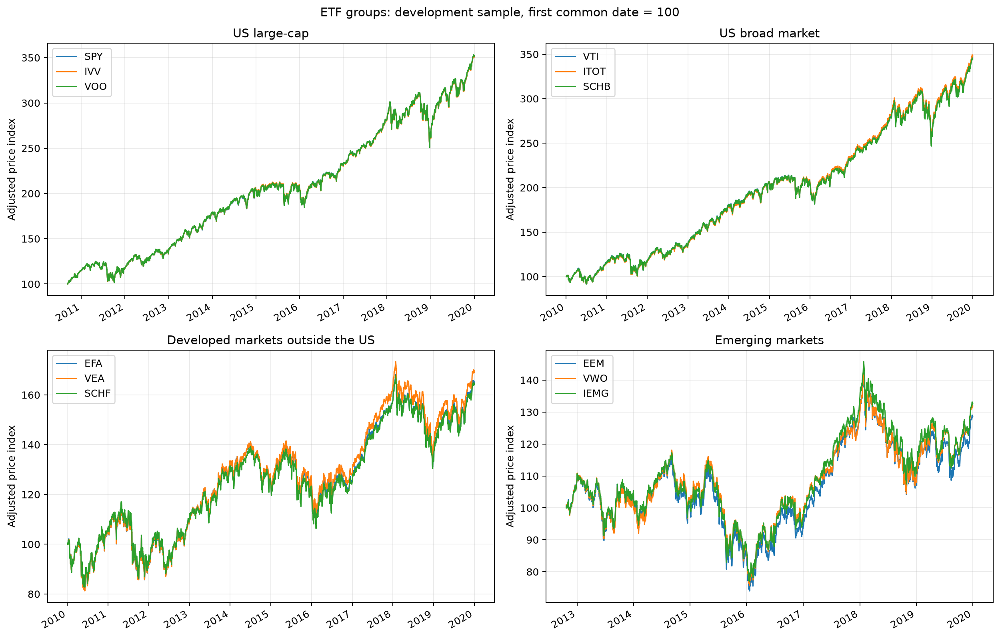

# Development Data Quality Review

## Dataset

Daily data for 12 US-listed equity ETFs were retrieved from Yahoo Finance
using yfinance. The review covers data availability, basic price and volume
checks, large daily returns, and candidate-pair coverage.

- Download date: October 30, 2026 UTC
- Requested sample: January 1, 2010 to December 31, 2019
- Observed date range: January 4, 2010 to December 31, 2019
- Number of ETFs: 12
- Candidate pairs: 12
- Combined price table: 2,516 dates and 12 ETF columns

Adjusted close is used for exploratory price and return analysis.
Unadjusted OHLC, volume, and available corporate-action fields are
retained in the raw files. Download metadata include file checksums.

## Coverage

Ten ETFs have 2,516 valid adjusted-price observations, beginning on
January 4, 2010. VOO has 2,344 observations beginning on September 9, 2010,
and IEMG has 1,807 observations beginning on October 24, 2012.
All 12 datasets end on December 31, 2019.

VOO and IEMG were established after the requested sample start.
Their issuer inception dates are September 7, 2010 and October 18, 2012,
respectively. The first available observations in the downloaded data
occur after those inception dates. These dates are recorded separately;
inception is not assumed to equal the first available trading observation.

| Group | First common date | Last common date | Common observations |
|---|---|---|---:|
| US large-cap | 2010-09-09 | 2019-12-31 | 2,344 |
| US broad market | 2010-01-04 | 2019-12-31 | 2,516 |
| Developed markets outside the US | 2010-01-04 | 2019-12-31 | 2,516 |
| Emerging markets | 2012-10-24 | 2019-12-31 | 1,807 |

Group coverage requires valid prices for all three constituent ETFs.
Individual pairs can therefore have longer histories than their group.

Full ETF coverage is recorded in
[the coverage table](../results/download_coverage_development.csv).
Issuer sources are documented in [Universe Notes](universe_notes.md).

## Missing Observations

No missing adjusted prices were found within the individual downloaded
files. After aligning the datasets, no internal or trailing missing prices
were detected against the union of observed ETF dates.

The combined price table contains 172 leading missing observations for
VOO and 709 for IEMG before their respective first available prices.
These leading gaps were retained.

No missing prices were forward-filled or backward-filled.
No internal gaps requiring treatment were identified by this check.

The reference dates come from the downloaded ETF datasets rather than
an independent exchange calendar. A session missing from every dataset
would not be detected by this method.

## Price and Volume Checks

| Check | Result |
|---|---:|
| Duplicate dates | 0 |
| Nonpositive adjusted prices | 0 |
| Infinite adjusted prices | 0 |
| Missing volume observations | 0 |
| Zero volume observations | 0 |
| Negative volume observations | 0 |

All individual date indexes were sorted. The adjusted-price checks
identified no invalid values requiring removal.

These checks establish basic structural consistency, not independent
verification of every price or a complete audit of unadjusted OHLC data.

## Large Daily Returns

No daily adjusted returns exceeded 10% in absolute value.
The ten largest absolute returns were nevertheless listed for review,
and the two largest were inspected in detail.

| ETF | Date | Adjusted return | Evidence inspected | Decision |
|---|---|---:|---|---|
| EFA | 2016-06-24 | -8.59% | Close fell from 58.70 to 53.66. The adjustment factor remained approximately 0.7448. No dividend or split was recorded on the date; a dividend was recorded on June 22. | Retain provisionally |
| EEM | 2011-08-08 | -8.34% | Close fell from 42.58 to 39.03. The adjustment factor remained approximately 0.7248. No dividend, split, or capital gain was recorded in the displayed seven-session window. | Retain provisionally |

Both declines appear in close and adjusted close without a material
adjustment-factor discontinuity on the reviewed date. No clear
corporate-action adjustment anomaly was identified in the displayed data.

Independent price verification remains outstanding. The other eight
observations in the ten-largest-moves table have not been individually
inspected in the saved notebook outputs.

Large returns were treated as review flags rather than automatically
removed. No observations were deleted during this review.

## Pair Availability

All 12 candidate pairs have at least 504 common observations over the
development sample.

| Pair category | Number of pairs | Common observations per pair | Date of 504th common observation |
|---|---:|---:|---|
| Pairs excluding VOO and IEMG | 8 | 2,516 | 2011-12-30 |
| Pairs containing VOO | 2 | 2,344 | 2012-09-06 |
| Pairs containing IEMG | 2 | 1,807 | 2014-10-27 |

The 504th common observation marks the accumulation of sufficient
historical observations for an initial formation sample. It is not
automatically a trade date.

This coverage check does not establish that every rolling formation
window is complete. It also provides no evidence of cointegration
or profitable trading.

Details are recorded in
[the pair coverage table](../results/pair_coverage.csv).

## Exploratory Charts

SPY, IVV, and VOO overlap closely throughout their common sample.
VTI, ITOT, and SCHB also follow similar paths, with small visible
differences in cumulative performance.

The developed-market group shows more separation, particularly in
parts of the later sample. The emerging-market ETFs share broad turning
points but diverge more visibly toward the end, with EEM finishing below
VWO and IEMG.

Benchmark coverage, country classifications, capitalization coverage,
expenses, and historical benchmark changes are possible explanations
to investigate. The charts alone do not identify the causes.

Each panel is rebased to 100 on its own first common date. Because
the panels cover different periods, their ending index levels should
not be compared directly.

Visual similarity does not establish spread stationarity, and visible
divergence does not establish temporary mispricing.

## Processing Decisions

Raw CSV files were preserved.

Date indexes were normalized, and the combined adjusted-price table
was sorted by date. Missing values were retained in that table.
Complete observations were selected separately for pair coverage
and group charts.

Daily returns were calculated without filling missing prices.
No outlier filtering, winsorization, interpolation, or manual price
correction was applied.

Processed prices were saved to Parquet. Reading the file back and
comparing it with the in-memory price table passed the notebook's
DataFrame equality check.

## Limitations

- The fixed universe was selected using present-day information and
  remains subject to selection and survivorship bias.
- Current benchmark descriptions may differ from historical exposures.
- Adjusted historical prices are not a point-in-time data archive.
- Missing dates were not checked against an independent exchange calendar.
- Only two of the ten largest daily moves were inspected in detail.
- Historical prices and corporate actions were not independently
  verified against another provider.
- Basic adjusted-price checks do not constitute a full OHLC audit.

## Readiness for Statistical Research

The dataset is suitable for initial pair-level statistical research:
all 12 pairs have sufficient historical observations, and the completed
checks identified no structural errors that currently block exploratory
OLS estimation or cointegration testing.

The remaining large-move reviews and independent calendar and price
checks should be completed before treating subsequent backtest results
as final. Any confirmed data issue must be documented and incorporated
into the processing pipeline before affected analyses are rerun.

The next stage is to examine log-price relationships, assess integration
properties, and test candidate pairs using formation data only.
No claim of cointegration or strategy profitability is made at this stage.