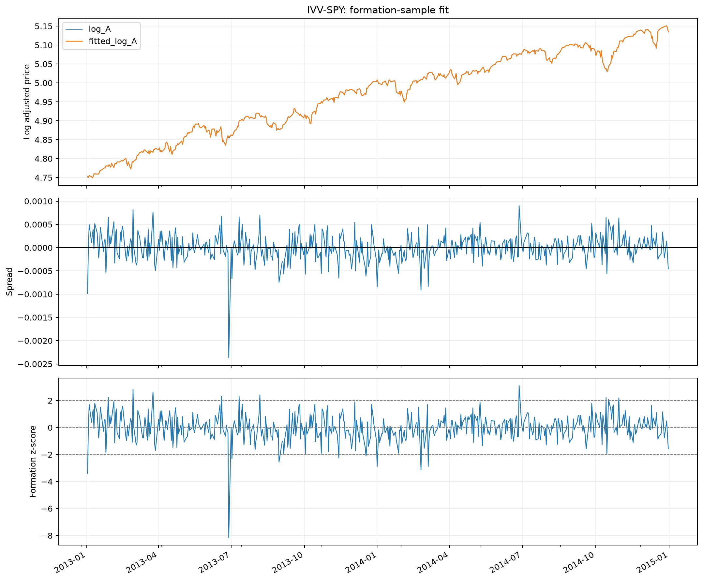

# Initial ETF Pair Research

## Result

IVV-SPY is the only qualifying pair among the 12 candidates in the
2013–2014 formation window. It passes the Engle–Granger test before
and after Holm correction. No pair qualifies in the other three groups.

This is a formation-sample result. No trading performance has been
calculated.

## Data and Method

The study uses 504 daily adjusted-price observations per ETF, from
January 2, 2013 to December 31, 2014.

The universe contains 12 ETFs in four groups, with three candidate
pairs per group. Only within-group pairs are tested.

For each pair, log prices are regressed by OLS with an intercept.
Regression direction is fixed alphabetically: the first ticker is
the dependent variable.

ADF diagnostics and Engle–Granger tests use an intercept and AIC
lag selection with a maximum of 12 lags. Holm correction is applied
across all 12 pair tests at the 5% level.

Selection requires a valid test, rejection after correction,
a positive hedge ratio, and a finite, positive spread standard
deviation. At most one pair is selected per group.

## Integration Diagnostics

For all 12 ETFs, ADF tests fail to reject a unit root in log prices
and reject one in first differences at the 5% level.

Log-level p-values range from 0.0874 to 0.6281.
All first-difference p-values are below 0.0001.

The results are consistent with the I(1) assumption under the chosen
specification. ADF outcomes are treated as diagnostics rather than
proof of integration order or an additional selection filter.

Detailed results are available in
[integration diagnostics](../results/week2/integration_diagnostics.csv).

## Pair Test Results

All 12 tests returned finite statistics and p-values. No
near-collinearity warnings were recorded.

| Measure | Count |
|---|---:|
| Candidate pairs | 12 |
| Numerically valid tests | 12 |
| Raw p-values below 0.05 | 1 |
| Rejections after Holm correction | 1 |
| Eligible pairs | 1 |
| Selected pairs | 1 |

IVV-SPY is the sole rejection both before and after correction.
The remaining 11 pairs have raw p-values above 0.05, so Holm
does not change the number of qualifying pairs in this window.

High correlation does not reliably identify the same relationship.
For example, SCHB-VTI has a return correlation of 0.9973 but a
cointegration p-value of 0.6995. IVV-VOO has a correlation of 0.9963
and a cointegration p-value of 0.8437.

Full results, including rejected candidates, are recorded in
[the pair research table](../results/week2/pair_research.csv).

## Selected Pair

| Statistic | IVV-SPY |
|---|---:|
| Daily return correlation | 0.998288 |
| OLS intercept | -0.018414 |
| OLS hedge ratio | 1.004200 |
| OLS R-squared | 0.999993 |
| Spread standard deviation | 0.0002903 |
| Engle–Granger statistic | -14.9601 |
| Raw p-value | 1.06e-26 |
| Holm-adjusted p-value | 1.27e-25 |

Both ETFs satisfy the reported I(1)-consistent diagnostic pattern.
No selected pair has a conflicting integration flag.

No pair qualifies in the US broad-market, developed ex-US,
or emerging-market groups. Under the current allocation rules,
those groups would remain in cash for a trading window using
this selection.

The high R-squared describes the formation fit. It is not a
separate test of cointegration or evidence of profitable trading.

## Formation Spread

IVV-SPY was specified as the illustrative pair before reviewing
the results. The estimated spread is:

spread = log(IVV) + 0.018414 - 1.004200 × log(SPY)

Its formation mean is approximately zero and its standard deviation
is 0.0002903 log-price units.

The near-zero mean follows from fitting OLS with an intercept;
it is not itself evidence of mean reversion. Likewise, the z-score's
mean of zero and standard deviation of one follow from normalization.

The spread is small, making trading costs an important question
for the next stage. Spread variability is not directly equivalent
to an achievable portfolio return.

All plotted values use parameters estimated over the complete
formation window. They are descriptive training-sample values,
not historically executable signals within that window.

## Verification

The notebook checks passed for:

- Spread construction using the estimated intercept and hedge ratio.
- Formation z-score normalization.
- Selection of at most one eligible pair per group.
- Unchanged formation estimates and test results after altering
  prices beyond the formation cutoff.

The last check verifies the current data slicing and estimation
pipeline. It does not yet test a trading engine.

## Limitations and Next Steps

One formation window is insufficient to establish a stable trading
relationship. The small p-value for IVV-SPY does not measure future
profitability or protect against relationship breakdown.

The data limitations documented in the
[Week 1 review](data_quality.md) remain relevant, including adjusted
historical prices and incomplete independent verification.

The next stage is to implement delayed signals and position
accounting using parameters fixed at the formation cutoff.
Transaction and borrowing costs will then be included before
assessing trading performance.